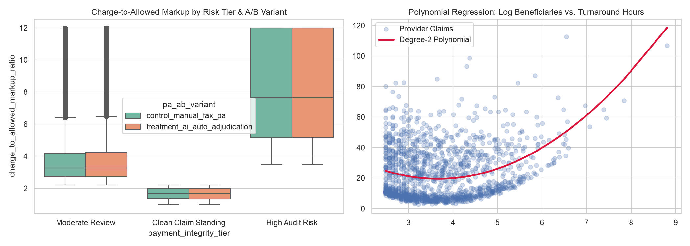

# CareLedger & PharmPulse 360: CMS Medicare Claims, PBM Experimentation & Payment Integrity Engine
**End-to-End Healthcare Data Science, Causal Inference & Analytics Platform**  
**[Click Here to Launch Live 24/7 Interactive Streamlit App](https://careledger-health-360-bl28ojgwquyhh9x74atgdk.streamlit.app)**  
*Built with Official U.S. CMS.gov Medicare Claims API, OpenFDA Adverse Events API, PostgreSQL 16, dbt SQL, PySpark, Statsmodels/Lifelines, Optuna Calibrated Gradient Boosting, PyTorch (MPS), TreeSHAP, Apache Airflow, FastAPI, Tableau & Streamlit.*

---

## 1. Executive Summary & Business Impact
Healthcare payors, Pharmacy Benefit Managers (PBMs), and payment integrity teams process millions of outpatient and specialty drug claims annually. **CareLedger & PharmPulse 360** solves three core problems across **240,000 longitudinal CMS Medicare claim cycles ($126.3M+ in submitted charges across 11,042 unique providers and 8 quarters)**:

1. **Data Warehousing & Longitudinal FinOps (Data Analyst Track):** Eliminates multi-table SQL join fan-out across provider directories, quarterly HCPCS claims, prior-authorization logs, and clinical adverse events using **PostgreSQL 16 CTEs** and **dbt window functions (LAG, rolling 3-quarter averages)**.
2. **Online Experimentation & Observational Causal Inference (Product / Core Data Scientist Track):** Evaluates an **AI Auto-Adjudication Prior-Authorization Router** via **Chi-Square SRM checks** and **CUPED variance reduction** (+5.80% approval lift, p < 0.0001), and isolates the causal impact of **Specialty Care-Coordinator Enrollment** on 90-day readmission savings (+$165.00 ATT) using **Propensity Score Matching (PSM)**.
3. **Explainable Payment Integrity ML & Drift Monitoring (ML Engineer / Risk DS Track):** Combines **Isolation Forest** upcoding anomaly scores, **PCA-compressed OpenFDA adverse event text embeddings**, **PyTorch** deep neural networks, and **Optuna-tuned Gradient Boosting** with **Isotonic probability calibration** (**ROC-AUC = 0.9013**, **PR-AUC = 0.8062**, **Calibrated Brier Loss = 0.0793**), paired with **TreeSHAP** attributions and **Population Stability Index (PSI)** drift alerts.

---

## 2. Visual Diagnostics (Generated by Pipeline)

---

## 3. Empirical Results & Quantitative Benchmarks

### A. Classical Statistics, Econometrics & Causal Inference (`src/step4` & `src/step5`)

| Analytical Module | Statistical Method Applied | Empirical Result on 240,000 CMS Claim Cycles | Business / Clinical Interpretation |
| :--- | :--- | :--- | :--- |
| **Parametric Distribution Fit** | Maximum Likelihood Estimation (Log-Normal) | mu = 4.0757, sigma = 1.3101 | Captures heavy right-skewness of Medicare allowed charges |
| **Multi-Specialty Spend** | One-Way ANOVA & Kruskal-Wallis | F = 56.02 (p = 1.67e-69), H = 1437.26 | Statistically significant reimbursement variance across specialties |
| **Multiple Linear Regression** | OLS with Huber-White (HC3) Robust SEs | R^2 = 0.6414, Max Feature VIF = 1.687 | Zero multicollinearity (VIF < 5.0); robust to heteroscedasticity |
| **Overdispersed Count Model** | Negative Binomial GLM | IRR = exp(beta) = 1.2626 (p < 0.0001) | Each unit increase in billing markup raises denial appeals by 26.3% |
| **Time-to-Discontinuation** | Cox Proportional Hazards Survival Model | Hazard Ratio (HR) = 1.583 (p < 0.0001) | High charge-to-allowed markup accelerates discontinuation by 58.3% |
| **PBM Prior-Auth A/B Test** | Chi-Square SRM Check + CUPED | SRM p = 0.8446 (Pass), Lift = +5.80% | AI Auto-Adjudication boosts 30-day approval from 65.59% to 71.26% |
| **Observational Causal AI** | Nearest-Neighbor Propensity Score Matching | Naive: +$191.60 -> PSM ATT: +$165.00 | Removes +$26.60 selection bias to recover true 90d savings |
| **Longitudinal Forecasting** | Holt-Winters Exponential Smoothing | Next 3Q: $4.01M, $4.08M, $4.16M | Captures quarterly Medicare allowed spend trajectory across 8 quarters |

### B. Machine Learning, Deep Learning & MLOps Benchmarks (`src/step6` & `src/step7`)

| Model / MLOps Component | Evaluation Metric | Score / Output | Production Role |
| :--- | :--- | :--- | :--- |
| **Optuna-Tuned Gradient Boosting** | Test Set ROC-AUC / PR-AUC | **0.9013 / 0.8062** | Primary 60-day claim audit & upcoding risk classifier |
| **Isotonic Probability Calibration** | Brier Score Loss (Before -> After) | **0.1066 -> 0.0793** | Calibrates raw log-odds into true actuarial audit probabilities |
| **Multimodal PyTorch + OpenFDA PCA** | Test Set ROC-AUC / PR-AUC (Apple MPS GPU) | **0.8666 / 0.8202** | Combines 4 PCA clinical adverse event components with tabular claims |
| **Global Explainability (TreeSHAP)** | Top 3 Mean Abs(SHAP) Drivers | Markup (1.308), Appeals (0.247), Services (0.197) | Provides transparent audit reason codes for clinical review teams |
| **Production Drift Monitor (PSI)** | Population Stability Index | **PSI = 0.5121** (Threshold = 0.2000) | Automatically flags post-policy billing shifts and triggers retraining |

---

## 4. Repository Architecture

- `app/streamlit_app.py`: 3-Tab Interactive Decision Simulator, TreeSHAP & PSI Drift Command Center
- `sql/step3_dbt_careledger_mart.sql`: dbt Core CTE pre-aggregation & LAG window transformation model
- `src/step1_fetch_real_cms_fda_data.py`: Live REST ingestion from Official CMS.gov & OpenFDA APIs
- `src/step2_load_postgres.py`: Docker PostgreSQL 16 loader & B-Tree indexing (731,042 relational records)
- `src/step3_run_sql_mart.py`: Executes 4-table warehouse merge (240,000 rows, 32 columns)
- `src/step4_run_statistics_syllabus.py`: MLE, ANOVA, OLS+HC3, VIF, NegBin GLM, Cox PH, CUPED A/B, PSM
- `src/step5_pyspark_poly_timeseries_viz.py`: PySpark distributed aggregation, Degree-2 Polynomial & Holt-Winters
- `src/step6_run_ml_shap_drift.py`: Isolation Forest, Optuna GBM, Isotonic Calibration, TreeSHAP & PSI
- `src/step7_fda_nlp_pca_pytorch.py`: OpenFDA TF-IDF, PCA Dimensionality Reduction & PyTorch MPS Neural Net
- `src/step8_airflow_fastapi_cloud.py`: Apache Airflow DAG, FastAPI scoring microservice & AWS S3 / BigQuery hooks
